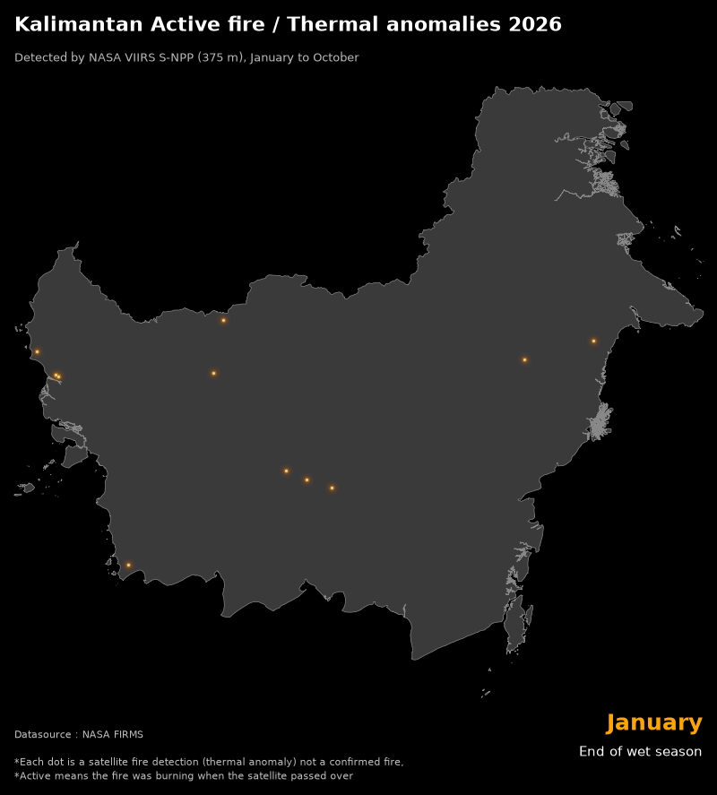
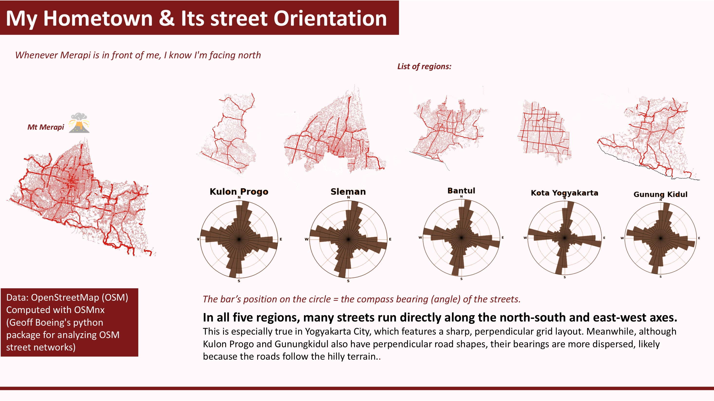
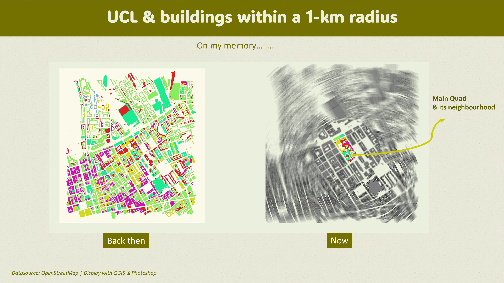
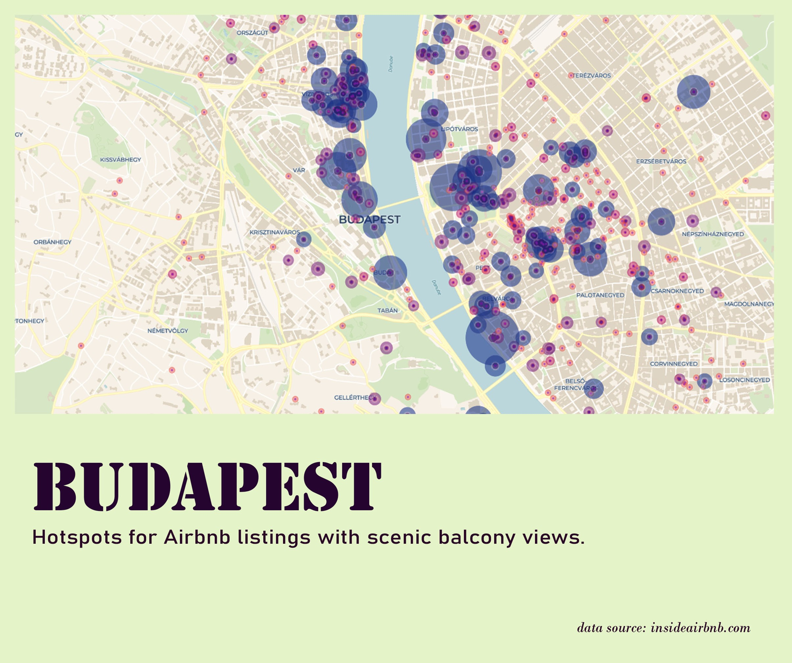

## Context

November 2026 is my first attempt to join #30DayMapChallenge sponsored by Mapbox. All projects are published on my linkedin page. I aim to deepern my skillset on Geospatial Data Science methods, while also focusing on open source dataset and methodology.

## Map Gallery

[Day 1](https://lnkd.in/p/gmss4ybH) - points

{width="374"}

[Day 2](https://lnkd.in/p/gm3cF9W8) - Lines

{width="426"}

[Day 3](https://lnkd.in/p/gGm7Utns) - Polygon

{width="430"}

[Day 4](https://lnkd.in/p/gWcYxwqb) - Clusters

{width="436"}
